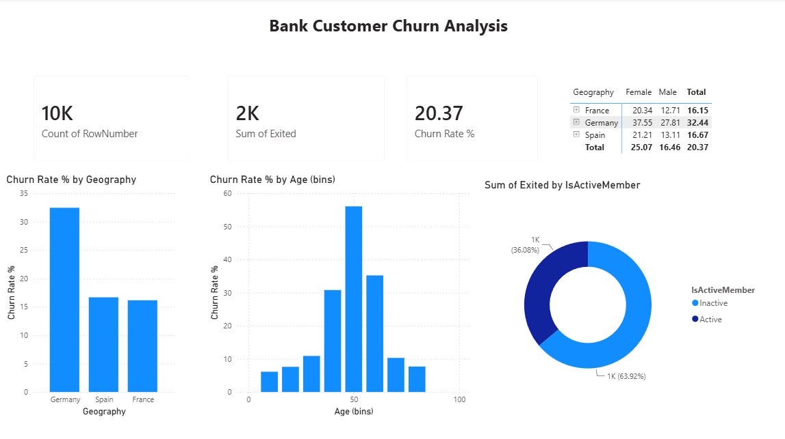

# Bank Customer Churn Analysis

## Objective
Find which bank customers are most likely to leave (churn) and suggest ways to keep them.

## Dataset
10,000 bank customers from the public Churn Modelling dataset.

## Tools Used
SQL Server (SSMS), Python (Pandas, Kaggle Notebooks), Power BI (DAX)

## Approach
1. SQL: wrote queries to compare churn across country, activity and number of products. (Edit to match what you did)
2. Python: cleaned the data and explored it with EDA. (Edit to match what you did)
3. Power BI: built an interactive dashboard with a Churn Rate % measure and age groups.

## Key Findings
- Overall churn rate: 20.4%
- Germany: 32% churn, vs about 16% in France and Spain
- Inactive members: 27% churn, vs 14% for active members
- Customers aged 40–60 churn the most
- Customers with 3–4 products churn above 80%

## Dashboard

## Recommendations
- Offer retention deals to inactive customers and customers in Germany.
- Review the 3–4 product bundles to find out why churn is so high.

## Files
- `Bank Churn Analytics.sql`: SQL queries (SSMS)
- `bank-churn-analysis.ipynb`: Python EDA notebook
- `Bank Customer Churn Analysis.pbix`: Power BI dashboard
- `Churn_Modelling.csv`: dataset
